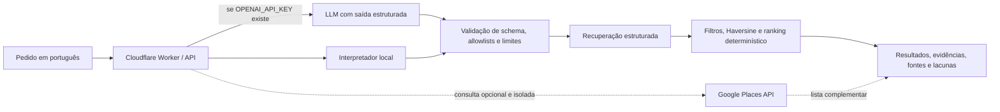
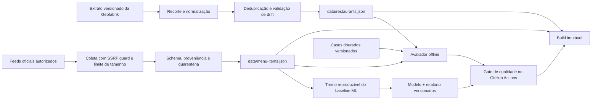

# Tô com Fome Fortaleza IA

[](https://github.com/igortavares2709-ops/to-com-fome-fortaleza-ia/actions/workflows/tests.yml)
[](https://perto-no-prato-fortaleza.botanicalanchovy2.chatgpt.site)

Sistema de busca gastronômica que transforma pedidos em português em uma intenção estruturada e recupera registros de restaurantes de Fortaleza com filtros, fontes e explicações verificáveis.

O desenho separa a parte probabilística da decisão final: um LLM pode interpretar a linguagem natural, mas código determinístico valida a saída, calcula distância, aplica cada restrição e monta as evidências. Sem chave, em timeout ou diante de uma saída inválida, o mesmo contrato é atendido por um interpretador local.

- **Demo:** [perto-no-prato-fortaleza.botanicalanchovy2.chatgpt.site](https://perto-no-prato-fortaleza.botanicalanchovy2.chatgpt.site)
- **System card e estudo técnico:** [docs/AI_ENGINEERING.md](docs/AI_ENGINEERING.md)
- **Licença dos dados:** [DATA_LICENSE.md](DATA_LICENSE.md)

Projeto independente inspirado no ecossistema de delivery. **Sem vínculo com o iFood e sem coleta de dados do iFood.**

## Problema e resultado

Perguntas como `pizza no Meireles com delivery` misturam intenção, localização e restrições. Um modelo generativo sozinho poderia sugerir um lugar inexistente, ignorar uma negação ou inventar preço. Este projeto usa IA somente onde ela ajuda a compreender a frase e mantém os fatos em uma camada rastreável.

O sistema já entrega:

- filtros por bairro, culinária, raio, delivery, retirada, acessibilidade, dieta, horário e cardápio;
- explicação “Por que apareceu” derivada dos campos efetivamente usados;
- estados distintos para **confirmado**, **não oferece** e **não informado**;
- localização opcional processada durante a busca, sem persistência;
- mapa interativo com OpenStreetMap e base vetorial local para falhas do serviço de blocos;
- consulta complementar opcional e transitória à Google Places API;
- coleta diária de cardápios oficiais autorizados, com proveniência, validação e quarentena de drift;
- fallback local, contrato estruturado do modelo, telemetria segura e avaliações offline no CI.

A base atual contém registros extraídos do OpenStreetMap. Isso não confirma que todos os estabelecimentos continuam em operação. A cobertura de preços está limitada a **dois restaurantes com feed oficial autorizado**; esse número é exposto nos metadados da aplicação e validado no build.

## Arquitetura online



O modelo **não escolhe restaurantes**. Ele produz campos como `neighborhood`, `cuisines`, `radiusKm`, `delivery` e `maxPriceBRL`. A saída passa por validação estrita e por listas de valores conhecidos antes da recuperação. Restrições identificadas pelo interpretador local, inclusive negações, não podem ser reativadas pelo modelo.

Este fluxo é **interpretação semântica com recuperação estruturada e fundamentada**. Ele não é descrito como RAG: os dados são tabulares e geográficos, e filtros determinísticos preservam restrições melhor do que adicionar embeddings sem uma hipótese mensurável. A “base vetorial local” citada no projeto contém geometrias do mapa, não vetores semânticos.

## Arquitetura offline



O workflow diário separa a atualização do OpenStreetMap da atualização de cardápios. Uma falha da Geofabrik conserva o snapshot anterior e não bloqueia os preços. Cada publicação usa o mesmo SHA que passou nas validações.

## Contrato da IA

| Campo | Tipo aceito | Regra de segurança |
|---|---|---|
| `neighborhood` | texto ou `null` | precisa existir na base |
| `cuisines` | lista de textos | somente categorias conhecidas |
| `radiusKm` | número ou `null` | positivo e limitado a 30 km |
| `maxPriceBRL` | número ou `null` | positivo; só filtra cardápios oficiais |
| `delivery`, `takeaway`, `wheelchair` | booleanos | negações locais têm precedência |
| `vegetarian`, `vegan`, `halal` | booleanos | exige confirmação explícita na fonte |
| `openNow`, `menuAvailable` | booleanos | não transforma dado ausente em fato |
| `unsupported` | lista controlada | registra pedidos sem cobertura, como avaliações |

O prompt e o schema possuem versões explícitas. A fronteira do provedor pede JSON Schema estrito e ainda repete a validação localmente, pois o retorno externo nunca é tratado como confiável. Uma resposta vazia, malformada, com campos extras ou tipos incorretos aciona o fallback e não é contabilizada como inferência generativa bem-sucedida.

## Avaliações reproduzíveis

```bash
npm run eval
```

O comando roda sem chave e sem rede sobre o conjunto versionado em `evals/intent-cases.jsonl`. Ele mede a interpretação e o comportamento ponta a ponta da recuperação, incluindo:

- acerto dos slots estruturados;
- respeito a negações e outras restrições críticas;
- abstenção quando o sistema não possui o dado solicitado;
- precisão das restrições nos resultados;
- presença de evidência para cada recomendação;
- latência p50/p95 apenas como diagnóstico, sem gate instável de tempo.

Os limites de regressão ficam no próprio avaliador e são executados no GitHub Actions. O relatório medido mais recente é versionado em `evals/results/local-baseline.json`; consulte esse arquivo para os números e o hash exatos do dataset. Essa baseline avalia o contrato determinístico local, não a qualidade geral de qualquer LLM.

Baseline local registrada no relatório atual:

| Medida | Resultado |
|---|---:|
| casos integralmente corretos | 50/50 |
| slots estruturados corretos | 101/101 |
| precisão das restrições | 100% em 381 resultados restritos |
| resultados com evidência e fonte | 100% em 669 resultados avaliados |
| violações de culinária negada | 0 |

Os 100% acima significam conformidade com este conjunto de aceitação curado. Não estimam desempenho em toda a linguagem natural nem substituem uma avaliação separada do LLM.

Resultados de um provedor pago só devem ser publicados depois de uma execução real que registre modelo, versão de prompt/schema, data, tokens, custo e latência. O repositório não transforma uma simulação ou o modo local em métrica de modelo generativo.

## Experimento de ML: classificação de cardápios

O repositório também treina um baseline próprio, `menu-category-nb-v1`, para classificar itens em cinco categorias amplas: bebida alcoólica, bebida sem álcool, entrada/acompanhamento, prato principal e sobremesa.

O experimento implementa **Multinomial Naive Bayes do zero**, sem biblioteca de machine learning. Usa apenas `name + description` como features, com palavras e bigramas. Os rótulos são fracos: vêm do mapeamento das categorias publicadas pelos dois restaurantes para a taxonomia comum. Preço, restaurante, URL e categoria de origem não entram nas features.

| Avaliação medida | Exemplos | Accuracy | Macro-F1 |
|---|---:|---:|---:|
| holdout estratificado e agrupado por nome | 70 | 0,8143 | 0,7731 |
| leave-one-restaurant-out | 280 | 0,6893 | 0,5993 |

O split mantém itens com o mesmo nome normalizado no mesmo lado e tem zero sobreposição de fingerprints. O resultado menor entre restaurantes revela a limitação de generalização que um holdout na mesma fonte esconderia. O artefato final é treinado nos 280 itens depois da medição.

As rotinas de aprovação e coleta diária regeneram o modelo antes dos testes. O fingerprint do corpus inclui somente restaurante, nome, descrição, categoria de origem e rótulo fraco; mudanças operacionais de preço, disponibilidade ou horário da coleta não criam uma nova versão artificial do modelo.

```bash
python scripts/train_menu_classifier.py train
python scripts/train_menu_classifier.py evaluate
python scripts/train_menu_classifier.py predict \
  --text "suco natural de caju sem álcool"
python -m unittest tests.test_menu_classifier -v
```

- **Model card:** [ml/MODEL_CARD.md](ml/MODEL_CARD.md)
- **Relatório completo:** [ml/results/menu-classifier-baseline.json](ml/results/menu-classifier-baseline.json)
- **Modelo serializado:** [ml/artifacts/menu-category-nb.json](ml/artifacts/menu-category-nb.json)

Esse classificador é um experimento offline e não participa do ranking nem da busca publicada. Ele não decide alergias, dieta, disponibilidade ou segurança alimentar. Os rótulos fracos, os dois restaurantes e a baixa cobertura de sobremesas impedem uso automático em produção.

## Observabilidade e fallback

Cada busca recebe um identificador novo. A resposta e os cabeçalhos de diagnóstico permitem acompanhar:

- provedor e modelo configurados;
- versões do prompt e do schema;
- outcome da chamada (`success`, timeout, limite do provedor, resposta malformada, schema rejeitado ou não configurado);
- uso do fallback;
- latência das etapas e tokens, quando o provedor os informa;
- contagem de resultados e versão dos dados.

`X-Request-ID` correlaciona a resposta e `Server-Timing` expõe durações sem revelar o pedido. O evento estruturado emitido pela aplicação não inclui texto pesquisado, IP, coordenadas, chave ou conteúdo bruto do modelo; a retenção dos logs de acesso da plataforma precisa ser administrada separadamente. O limite em memória do Worker reduz abuso por instância; antes de ativar uma chave em escala, também é necessário configurar cotas no provedor ou um limitador distribuído.

Falha do LLM, Google Places ou servidor de mapa não derruba a busca local. O modo utilizado fica visível na interface. A demo pública pode operar somente com o interpretador local quando `OPENAI_API_KEY` não está configurada; sua disponibilidade não é apresentada como prova de que um modelo pago está ativo.

## Executar localmente

Requisitos: Node.js 22 ou superior e Python 3.12 para a suíte completa. Não há dependências de produção.

```bash
npm test
npm run test:python
npm run eval
npm run check:data
npm run build
npm run build:pages
npm run check:build
npm run dev
```

Abra `http://127.0.0.1:8787`.

Para experimentar a interpretação generativa, configure a chave somente no servidor:

```bash
export OPENAI_API_KEY='...'
export OPENAI_MODEL='gpt-4.1-mini'
npm run dev
```

Nunca coloque chaves no JavaScript do navegador ou em commits. O `.env.example` documenta as variáveis, mas o projeto não carrega `.env` automaticamente.

### Google Places

A integração oficial exige uma conta Google Cloud com faturamento, Places API (New) habilitada e chave restrita à API, com cotas de custo:

```bash
export GOOGLE_PLACES_API_KEY='...'
npm run dev
```

A chave permanece no Worker. O navegador recebe no máximo oito resultados em texto com atribuição Google Maps. A consulta só ocorre após ação do visitante, não é salva nem combinada com o snapshot OpenStreetMap. A versão estática do GitHub Pages usa apenas a base local.

## Pipeline e governança dos dados

O workflow `.github/workflows/daily-update.yml` roda todos os dias às **06:15 no horário de Fortaleza** (`09:15 UTC`) e também aceita execução manual. Ele:

1. resolve uma versão imutável do extrato Nordeste da Geofabrik;
2. restringe domínio, protocolo e caminho antes do download;
3. verifica o MD5 e reutiliza cache por versão;
4. recorta o município pela relação OSM `302588` / IBGE `2304400`;
5. normaliza e deduplica nomes próximos;
6. rejeita variação suspeita na quantidade de registros;
7. atualiza feeds oficiais com concorrência limitada;
8. preserva o último cardápio válido em falhas e coloca reduções abruptas em quarentena;
9. regenera o baseline de classificação quando o corpus de nome, descrição ou categoria muda;
10. executa testes, evals, validação dos dados e builds;
11. publica exatamente a revisão validada.

`data/restaurants.json` registra URL e data do snapshot. `data/menu-items.json` registra fonte, data declarada, data de coleta e estado `stale`. `npm run check:data` verifica as contagens e a integridade antes de publicar.

O Google Maps não forma nem reescreve o dataset. Sua resposta permanece transitória e identificada separadamente para cumprir os termos da API.

### Reproduzir a extração OSM

```bash
python scripts/extract_geofabrik.py \
  --pbf /caminho/nordeste-AAMMDD.osm.pbf \
  --snapshot-date AAAA-MM-DD \
  --source-url https://download.geofabrik.de/south-america/brazil/nordeste-AAMMDD.osm.pbf
```

O script requer GDAL/`ogr2ogr`. O PBF, com centenas de megabytes, é armazenado em cache e não entra no Git. `data/fortaleza-restaurants.overpassql` oferece uma rota alternativa de consulta.

### Cardápios e preços

O projeto não raspa cardápios do iFood. `data/official-menu-feeds.json` permite apenas fontes públicas ou autorizadas nos formatos:

- `json_v1`: moeda, data e lista de itens;
- `csv_v1`: nome, preço, descrição, categoria, disponibilidade e moeda;
- `jsonld_menu`: `MenuItem` e `Offer` publicados pela fonte oficial.

O cadastro pela interface abre uma solicitação pública no GitHub. A importação exige revisão humana, autorização, vínculo exato com a unidade, validação contra SSRF e confirmação de que o issue não mudou desde a revisão. Nenhuma fonte entra diretamente na coleta diária.

As imagens gastronômicas são ilustrativas e nunca são apresentadas como pratos dos restaurantes listados.

## Segurança e ameaças consideradas

| Risco | Controle atual |
|---|---|
| prompt injection | pedido é serializado como dado; schema e allowlists limitam a saída |
| alucinação de restaurante ou preço | LLM não seleciona registros; fatos vêm do snapshot e feeds rastreados |
| saída inválida do modelo | validação local e fallback classificado |
| vazamento de chave | credenciais apenas no servidor e fora de logs/respostas |
| abuso/custo | limite de entrada, timeout, same-origin, rate limit local e recomendação de cota externa |
| SSRF em feed | resolução pública, bloqueio de credenciais/portas/hosts e endereço fixado na conexão |
| corrupção de cardápio | validação integral, último valor válido e quarentena de drift |
| alteração após revisão | aprovação vinculada ao `updatedAt` revisado e push protegido por SHA |
| XSS e recursos externos | renderização com `textContent`, CSP e bibliotecas hospedadas localmente |

O desenho e as limitações detalhadas ficam no [system card](docs/AI_ENGINEERING.md).

## Limitações conhecidas

- OpenStreetMap é colaborativo; registros podem estar incompletos, desatualizados ou representar locais encerrados.
- “Não informado” não significa “não oferece”.
- `opening_hours` cobre formatos comuns; expressões complexas resultam em estado desconhecido.
- Apenas dois restaurantes possuem preços oficiais automatizados; não há taxa/tempo de entrega nem avaliações.
- O parser local cobre o contrato testado, mas não substitui uma avaliação de linguagem aberta em produção.
- A demo sem chave não mede a qualidade de um LLM.
- O classificador de cardápios usa rótulos fracos de somente dois restaurantes e permanece fora do runtime.
- O rate limit em memória não é global entre isolates.
- Google Places, LLM e blocos detalhados do mapa dependem de serviços e cotas externos.
- Geolocalização exige permissão do navegador e não é armazenada.
- O projeto não confirma segurança para alergias.

## Aderência à Trilha AI Engineer

A [vaga oficial](https://job-boards.greenhouse.io/ifoodcarreiras/jobs/8901054002) descreve dois caminhos: construir e integrar software para produtos de IA **ou** construir e operacionalizar modelos, com ênfase em LLMs. Este repositório demonstra o primeiro caminho e partes operacionais do segundo:

| Expectativa publicada | Evidência no projeto |
|---|---|
| desenvolvimento de software | Worker, API, interface, testes, CI e artefatos para Worker e GitHub Pages |
| integração de soluções de IA | LLM com contrato estruturado, validação, fallback e recuperação fundamentada |
| implementação de ML | Multinomial Naive Bayes do zero, artefato serializado, model card e avaliação por restaurante |
| operação de pipelines | ingestão diária, proveniência, drift, quarentena e publicação imutável |
| qualidade de IA | dataset dourado, métricas offline e gate de regressão |
| manutenção em produção | observabilidade, classificação de falhas e degradação controlada |
| impacto em produto | busca local utilizável, fontes explícitas e onboarding de restaurantes |

O baseline de ML demonstra treino e avaliação reproduzíveis, mas não é um fine-tuning de LLM e não está implantado no produto. A diferença entre holdout e leave-one-restaurant-out está documentada para não apresentar a métrica mais favorável como capacidade de generalização.

## Estrutura principal

- `src/worker.mjs`: contrato da IA, API, recuperação, observabilidade e servidor.
- `evals/`: casos dourados e relatório local medido.
- `scripts/run-evals.mjs`: avaliação e gates de regressão.
- `scripts/train_menu_classifier.py`: treino, avaliação e inferência do baseline de ML.
- `ml/`: artefato serializado, relatório medido e model card.
- `tests/`: testes do runtime, regras, rotas, ingestão e segurança.
- `data/restaurants.json`: snapshot normalizado do OpenStreetMap.
- `data/menu-items.json`: preços coletados com proveniência.
- `scripts/update_menu_feeds.py`: ingestão segura de cardápios.
- `.github/workflows/`: CI, atualização diária e aprovação de fontes.
- `docs/AI_ENGINEERING.md`: arquitetura, system card, decisões e runbook.

O código está sob MIT. A base derivada mantém ODbL 1.0. Leaflet usa BSD-2-Clause, com atribuição OpenStreetMap visível.
