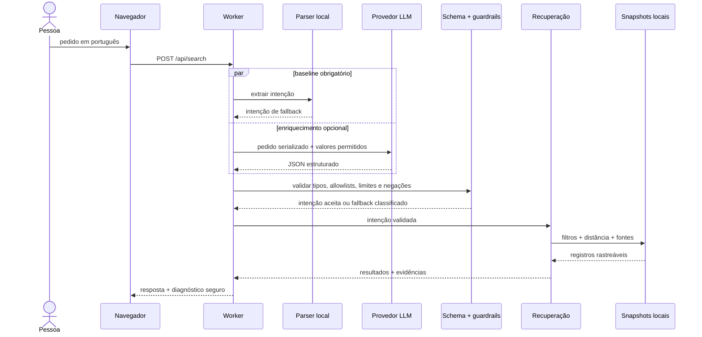

# AI Engineering System Card

## Documento

| Item | Valor |
|---|---|
| Sistema | Tô com Fome Fortaleza IA |
| Domínio | descoberta de restaurantes em Fortaleza |
| Tipo | NLU híbrida + recuperação estruturada e fundamentada |
| Interface de modelo | OpenAI Chat Completions com Structured Outputs |
| Versão do prompt | `intent-v2` |
| Versão do schema | `restaurant-search-intent-v1` |
| Operação sem modelo | interpretador local determinístico |
| Decisão final | filtros e ranking em código |
| Dataset online | snapshot OpenStreetMap + feeds oficiais autorizados |
| Avaliação offline | `evals/intent-cases.jsonl` |
| Relatório medido | `evals/results/local-baseline.json` |
| Experimento de ML | `menu-category-nb-v1` |
| Model card | `ml/MODEL_CARD.md` |

Este documento descreve o sistema online. O repositório também contém um classificador treinado de categorias de cardápio, documentado separadamente em [`ml/MODEL_CARD.md`](../ml/MODEL_CARD.md). Esse modelo é um experimento offline e não participa das decisões da aplicação publicada. O objetivo aqui é tornar explícitos contrato, decisões, avaliações, falhas e responsabilidades da integração de IA em produção.

## 1. Objetivo e escopo

O sistema recebe um pedido curto em português, como “pizza no Meireles com delivery”, e devolve registros presentes na base que respeitam as restrições identificadas. Cada resultado inclui razões e links para a origem dos dados.

Casos de uso previstos:

- descobrir registros por bairro e culinária;
- restringir por raio quando existe uma referência geográfica;
- exigir atributos explicitamente confirmados, como delivery ou acessibilidade;
- consultar cardápios e preços quando existe uma fonte oficial rastreada;
- informar quando um pedido depende de um dado ausente.

Fora de escopo:

- confirmar que um estabelecimento continua aberto no mundo real;
- recomendar com base em perfil pessoal, avaliações ou histórico;
- calcular prazo, taxa ou disponibilidade de entrega;
- oferecer orientação sobre alergias;
- inferir preço quando não existe feed oficial;
- copiar dados ou cardápios do iFood.

## 2. Hipótese de engenharia

A hipótese central é que a linguagem natural se beneficia de um parser probabilístico, enquanto filtros geográficos e comerciais precisam de comportamento verificável.

Uma solução em que o LLM recebe a lista de restaurantes e escreve uma recomendação teria três problemas:

1. poderia criar ou alterar fatos;
2. seria difícil provar que todas as restrições foram aplicadas;
3. aumentaria tokens, latência e custo à medida que a base crescesse.

Por isso, o LLM recebe somente o pedido e os vocabulários permitidos. Sua saída é uma intenção pequena. O restante do pipeline é determinístico.

## 3. Fluxo online



O parser local não é apenas contingência: ele estabelece restrições mínimas que o modelo não pode remover. Se o pedido contém “sem pizza”, uma saída posterior que tenta adicionar pizza é descartada.

## 4. Contrato de intenção

O contrato possui versão explícita e não aceita propriedades adicionais.

```json
{
  "neighborhood": "Meireles",
  "cuisines": ["pizza"],
  "radiusKm": null,
  "maxPriceBRL": null,
  "delivery": true,
  "takeaway": false,
  "wheelchair": false,
  "vegetarian": false,
  "vegan": false,
  "halal": false,
  "openNow": false,
  "menuAvailable": false,
  "unsupported": []
}
```

Validações posteriores ao provedor:

- o objeto precisa conter exatamente os campos esperados;
- tipos precisam corresponder ao schema;
- bairro e culinárias precisam existir nos vocabulários do snapshot;
- raio é limitado a 30 km;
- preço precisa ser positivo e só atua sobre itens oficiais;
- negações reconhecidas localmente prevalecem;
- valores não suportados não viram filtros silenciosos;
- resposta vazia ou sem contribuição válida é classificada como rejeitada.

O pedido é enviado como conteúdo serializado, não concatenado às instruções. Ainda assim, o modelo é tratado como uma fronteira não confiável.

## 5. Recuperação: por que não RAG

O projeto usa filtros estruturados e distância de Haversine sobre dados tabulares e geográficos. Não existe banco vetorial, embedding ou geração aumentada por contexto.

Essa decisão é intencional:

- igualdade de bairro e flags de serviço exigem precisão, não similaridade aproximada;
- negações precisam excluir resultados;
- preço precisa ser comparado numericamente;
- distância precisa de coordenadas;
- cada explicação deve apontar para o campo que justificou a inclusão.

Embeddings fariam sentido em um experimento futuro de similaridade entre descrições de pratos, desde que comparados com um baseline lexical e avaliados em recall, precisão, custo e latência. Adicioná-los sem essa hipótese só aumentaria a complexidade.

## 6. Dados e proveniência

### Restaurantes

- origem: extrato Nordeste da Geofabrik / OpenStreetMap;
- recorte: município de Fortaleza, relação OSM `302588`;
- critério: `amenity=restaurant` com nome;
- deduplicação: nome normalizado e proximidade de até 40 metros;
- licença: ODbL 1.0;
- artefato: `data/restaurants.json`.

Um registro OSM não prova que o local permanece em operação. A interface oferece o link da fonte para conferência.

### Cardápios

- origens: feeds públicos ou autorizados pelo restaurante;
- formatos: JSON versionado, CSV versionado e JSON-LD;
- artefatos: `data/official-menu-feeds.json` e `data/menu-items.json`;
- cobertura atual de preço: dois restaurantes;
- proteção: tamanho máximo, validação integral, SSRF guard, proveniência e quarentena.

Uma falha conserva o último snapshot válido e marca o conteúdo como desatualizado. Uma redução abrupta ou troca quase integral de itens não é publicada automaticamente.

### Google Places

É uma consulta complementar, transitória e opt-in. O conteúdo não é incorporado aos snapshots, não é misturado aos marcadores OSM e mantém a atribuição do Google Maps.

### Dataset do classificador de cardápios

O experimento `menu-category-nb-v1` usa os 280 itens dos dois feeds oficiais. A categoria publicada pelo restaurante fornece um rótulo fraco para cinco classes:

| Classe | Itens |
|---|---:|
| bebida alcoólica | 97 |
| bebida sem álcool | 37 |
| entrada/acompanhamento | 55 |
| prato principal | 79 |
| sobremesa | 12 |

Somente nome e descrição viram features. Preço, ID do restaurante, URL e categoria de origem ficam fora da entrada do modelo. Os rótulos não foram revisados item a item por especialistas e medem concordância com a taxonomia derivada das fontes, não uma verdade culinária universal.

## 7. Avaliação

### Dataset

`evals/intent-cases.jsonl` é um conjunto de aceitação versionado em português. Os grupos incluem:

- bairro e culinária;
- filtros booleanos;
- preço e raio;
- negações e conflitos;
- pedido sem referência geográfica;
- dado sem cobertura;
- texto ambíguo e palavras parciais;
- tentativa de prompt injection;
- entrada vazia.

Esse conjunto valida o contrato conhecido e protege contra regressões. Ele não representa toda a distribuição de linguagem de Fortaleza e não deve ser apresentado como benchmark geral de compreensão.

### Métricas

| Métrica | Definição | Uso |
|---|---|---|
| slots corretos | campos esperados que coincidem com o gold | acompanha regressão da intenção |
| F1/micro ou equivalente | acertos agregados de valores estruturados | resume capacidades com múltiplos slots |
| violação de negação | resultado contém atributo explicitamente excluído | gate crítico: deve ser zero |
| precisão de restrição | resultados que respeitam todos os filtros aplicáveis | gate crítico |
| abstenção | pedido sem suporte é sinalizado em `unsupported` ou sugestão | evita invenção |
| fundamentação | resultado possui motivo e fonte correspondente | gate crítico |
| p50/p95 | tempo da avaliação local | diagnóstico, não gate |

### Reproduzir

```bash
npm run eval
```

O relatório em `evals/results/local-baseline.json` contém os números executados e o hash do dataset. A CI executa o mesmo comando e falha quando um gate de qualidade regride.

Avaliações de LLM devem ser separadas da baseline local. Um relatório de provedor precisa registrar ao menos:

- provedor e modelo exatos;
- versões de prompt e schema;
- commit e hash do dataset;
- data e configuração;
- tokens, custo estimado e latências;
- taxa de cada outcome e fallback;
- análise dos erros.

Nenhuma métrica de LLM deve ser inferida a partir de mocks.

### Classificador offline

O script `scripts/train_menu_classifier.py` implementa Multinomial Naive Bayes do zero, com normalização Unicode, palavras, bigramas e suavização de Laplace `alpha=1`. Não depende de scikit-learn nem de outro pacote de ML.

O holdout é estratificado por classe e agrupado pelo fingerprint do nome normalizado. Assim, produtos com o mesmo nome não atravessam treino e teste. O segundo protocolo treina em um restaurante e testa no outro, alternando a fonte:

| Avaliação | Exemplos | Accuracy | Macro-F1 |
|---|---:|---:|---:|
| holdout agrupado por nome | 70 | 0,8143 | 0,7731 |
| leave-one-restaurant-out | 280 | 0,6893 | 0,5993 |

A queda entre os protocolos é uma evidência de mudança de domínio entre cardápios. `entrada_acompanhamento` e `sobremesa` são as classes mais frágeis; sobremesa tem somente 12 exemplos. Por isso, o modelo final serializado, embora treinado nos 280 itens, não está conectado ao runtime.

Os workflows de aprovação e coleta diária executam o treino antes da validação e versionam artefato e relatório quando o corpus muda. O fingerprint canônico usa somente restaurante, nome, descrição, categoria de origem e rótulo fraco; preço, disponibilidade e timestamps não geram mudanças artificiais no modelo.

```bash
python scripts/train_menu_classifier.py train
python scripts/train_menu_classifier.py evaluate
python scripts/train_menu_classifier.py predict \
  --text "suco natural de caju sem álcool"
python -m unittest tests.test_menu_classifier -v
```

Matriz de confusão, métricas por classe, hash do dataset e distribuição por fonte ficam em [`ml/results/menu-classifier-baseline.json`](../ml/results/menu-classifier-baseline.json). O artefato está em [`ml/artifacts/menu-category-nb.json`](../ml/artifacts/menu-category-nb.json).

## 8. Observabilidade e privacidade

Uma busca produz diagnóstico operacional com:

- `requestId`;
- provider/model;
- prompt/schema version;
- outcome;
- uso de fallback;
- duração da interpretação, recuperação e total;
- tokens quando fornecidos;
- quantidade de resultados.

Os cabeçalhos `X-Request-ID` e `Server-Timing` permitem correlação e inspeção no navegador.

O evento estruturado emitido pela aplicação não registra:

- pedido em texto;
- IP;
- latitude/longitude;
- chave;
- conteúdo bruto enviado ou recebido do modelo.

Essa política reduz utilidade para uma análise linguística posterior, mas evita transformar a telemetria da aplicação em um novo dataset pessoal sem consentimento. Logs de acesso mantidos pela plataforma de hospedagem seguem configuração e retenção próprias. Estudos de erros devem usar casos sintéticos ou voluntariamente revisados e anonimizados.

## 9. Taxonomia de falhas

| Outcome | Significado | Comportamento |
|---|---|---|
| `not_configured` | chave ausente | parser local |
| `success` | saída válida e aceita | merge protegido + recuperação |
| `timeout` | provedor excedeu o limite | parser local |
| `rate_limited` | provedor recusou por cota | parser local |
| `provider_error` | HTTP/serviço indisponível | parser local |
| `malformed_response` | resposta não é JSON utilizável | parser local |
| `schema_rejected` | JSON viola o contrato | parser local |

Uma falha do Google Places é independente e não altera a busca local. Uma falha do mapa detalhado mantém a base vetorial local e a lista.

## 10. Segurança

### Ameaças tratadas

- **Prompt injection:** serialização, instrução de tratar o pedido como dado, schema estrito e allowlists.
- **Alucinação:** o modelo não recebe a responsabilidade de escolher registros ou preços.
- **Saída adversarial:** validação de propriedades, tipos, limites e vocabulários.
- **Abuso de API:** same-origin, tamanho máximo, comprimento de texto, timeout e rate limit.
- **Exposição de segredo:** chaves somente no Worker, sem eco em resposta/log.
- **SSRF no onboarding:** protocolo, hostname, porta, DNS público, redirecionamentos e IP conectado validados.
- **Envenenamento de feed:** revisão humana, esquema, proveniência, drift e último valor válido.
- **Supply chain:** Leaflet hospedado localmente e CI com permissões mínimas.

### Riscos residuais

- o rate limit em memória vale por isolate e não protege uma cota global;
- o provedor continua sujeito a indisponibilidade e mudanças de comportamento;
- allowlists refletem o snapshot e podem conter rótulos incompletos;
- o conjunto dourado é pequeno e curado;
- o classificador foi treinado com weak labels e somente dois restaurantes;
- a confiança do Naive Bayes não é calibrada;
- uma fonte oficial pode publicar informação incorreta;
- dados colaborativos podem carregar vieses de cobertura geográfica e econômica.

Antes de ativar uma chave com tráfego significativo, configure cotas/RPM/TPM no provedor ou um limitador distribuído.

## 11. Operação e runbook

### Busca com aumento de fallback

1. observar taxa de outcomes por versão do prompt/modelo;
2. separar timeout, limite do provedor, erro HTTP e schema;
3. verificar cota e status do provedor;
4. executar `npm run eval`;
5. comparar versão do prompt/schema com a última baseline;
6. manter o parser local ativo enquanto investiga.

### Regressão de qualidade

1. reproduzir o caso sem rede;
2. adicionar um caso mínimo ao conjunto dourado;
3. corrigir parser, validação ou recuperação;
4. confirmar gates e testes;
5. revisar se a alteração muda o contrato;
6. incrementar a versão correspondente.

### Mudança de modelo

1. fixar o nome exato do candidato;
2. executar avaliação controlada com o mesmo dataset;
3. comparar qualidade, fallback, latência e custo;
4. revisar casos de prompt injection e negação;
5. atualizar versão/configuração;
6. liberar com possibilidade de retorno ao modelo anterior.

### Drift de dados

1. não sobrescrever o snapshot anterior;
2. conferir contagens e sobreposição de itens;
3. revisar a fonte e o status HTTP;
4. aprovar manualmente apenas quando a mudança for legítima;
5. manter `stale: true` quando não for possível confirmar.

## 12. Limitações e uso responsável

- A aplicação é ferramenta de descoberta, não diretório comercial verificado.
- A ausência de um atributo não autoriza uma conclusão negativa.
- O modo “aberto agora” depende de formatos de horário que o parser reconhece.
- Resultados de preço cobrem somente os feeds oficiais disponíveis.
- Nenhum resultado deve orientar decisão médica ou de alergia.
- O usuário precisa confirmar horário, preço, acessibilidade e serviço diretamente com o estabelecimento.
- A demo pode operar sem LLM; o badge de modo informa o caminho efetivamente usado.
- O classificador de cardápios não decide ranking, dieta, alergias, disponibilidade ou qualquer resposta do produto.

## 13. Relação com a Trilha AI Engineer

A [vaga oficial do Programa GenAI](https://job-boards.greenhouse.io/ifoodcarreiras/jobs/8901054002) descreve atuação em construção e integração de software para produtos de IA ou operacionalização de modelos, com ênfase em LLMs. O projeto oferece evidência concreta de:

- integração de LLM em uma API com fronteira e contrato explícitos;
- implementação do zero de um classificador de texto, com artefato e model card;
- comparação entre holdout agrupado e generalização entre restaurantes;
- fallback e operação sem dependência total do provedor;
- testes adversariais e avaliação offline;
- observabilidade que preserva privacidade;
- pipeline de dados com proveniência e proteção contra drift;
- deployment, CI e aplicação utilizável.

O classificador próprio cobre uma baseline lexical reproduzível; não é fine-tuning de LLM nem está publicado no Hugging Face. Próximos experimentos coerentes são:

1. obter rótulos humanos e ampliar o número de restaurantes;
2. reservar validação e teste por restaurante, sem usar os mesmos locais no desenvolvimento;
3. comparar TF-IDF + regressão logística e um encoder em português;
4. calibrar confiança e criar uma política explícita de abstenção;
5. publicar um artefato somente se superar a baseline entre restaurantes;
6. manter model card, licença, métricas por classe e análise de erro junto ao modelo.
